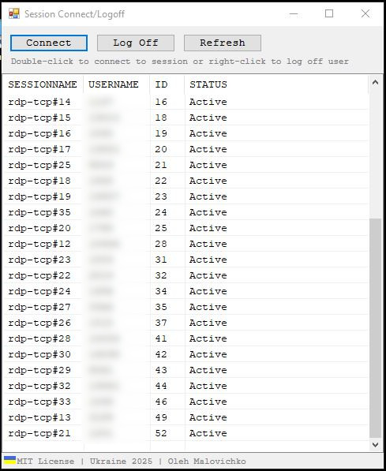

# ShadowRDP
---

Сonnecting to and disconnecting from RDP client terminal sessions.

Tested on Windows Server 2022 Standard

Work only with administrator rights.


<br>

## Server setup

To connect to a session without the user's consent prompt, allow full control via Group Policy on the server.

1. Press `Win + R`, run `gpedit.msc`.
2. Go to:
   `Computer Configuration` → `Administrative Templates` → `Windows Components` → `Remote Desktop Services` → `Remote Desktop Session Host` → `Connections`
   (RU: `Конфигурация компьютера` → `Административные шаблоны` → `Компоненты Windows` → `Службы удаленных рабочих столов` → `Узел сеансов удаленных рабочих столов` → `Подключения`)
3. Open the policy **Set rules for remote control of Remote Desktop Services user sessions**
   (RU: «Задать правила удаленного управления пользовательскими сеансами служб удаленных рабочих столов»).
4. Select **Enabled**.
5. In *Options* choose **Full Control without user's permission**
   (RU: «Полный контроль без разрешения пользователя»).
6. Click **Apply** → **OK**.

Then apply the policy from an elevated command prompt:

```
gpupdate /force
```

Policy names may differ slightly depending on the Windows Server version.

## Building

`build.cmd` builds `shadow.exe` from `shadow.ps1` using [ps2exe](https://github.com/MScholtes/PS2EXE) (`Install-Module ps2exe -Scope CurrentUser`).

---
Ukraine 2025
Oleh Malovichko
